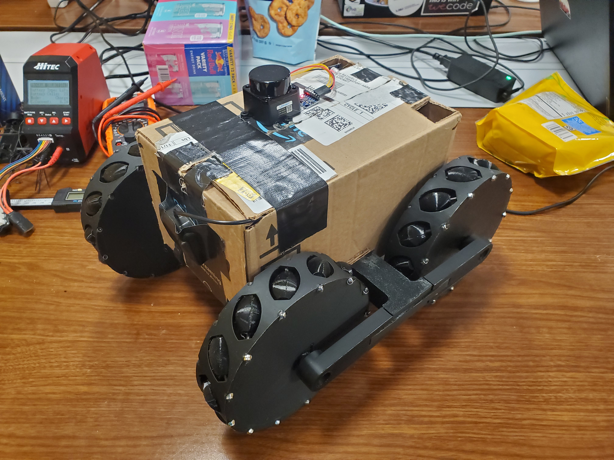
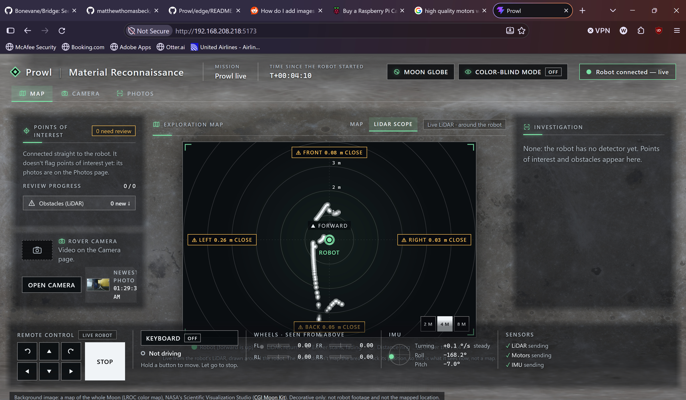
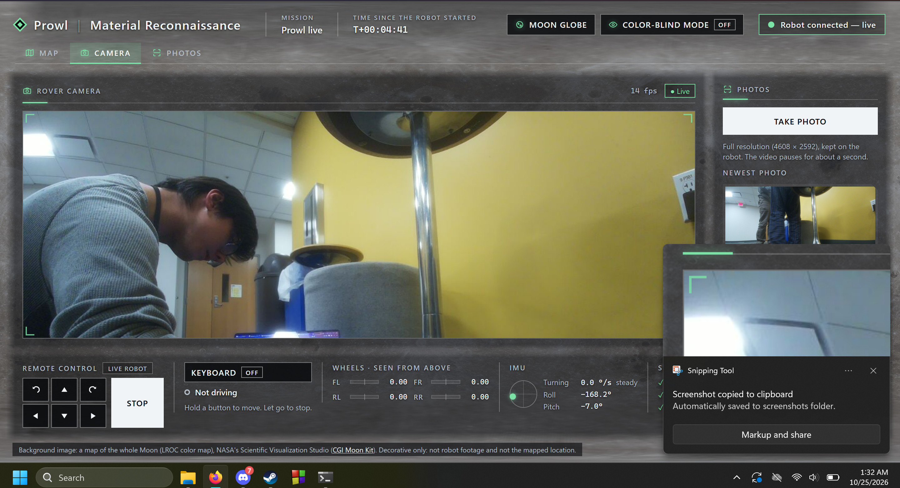
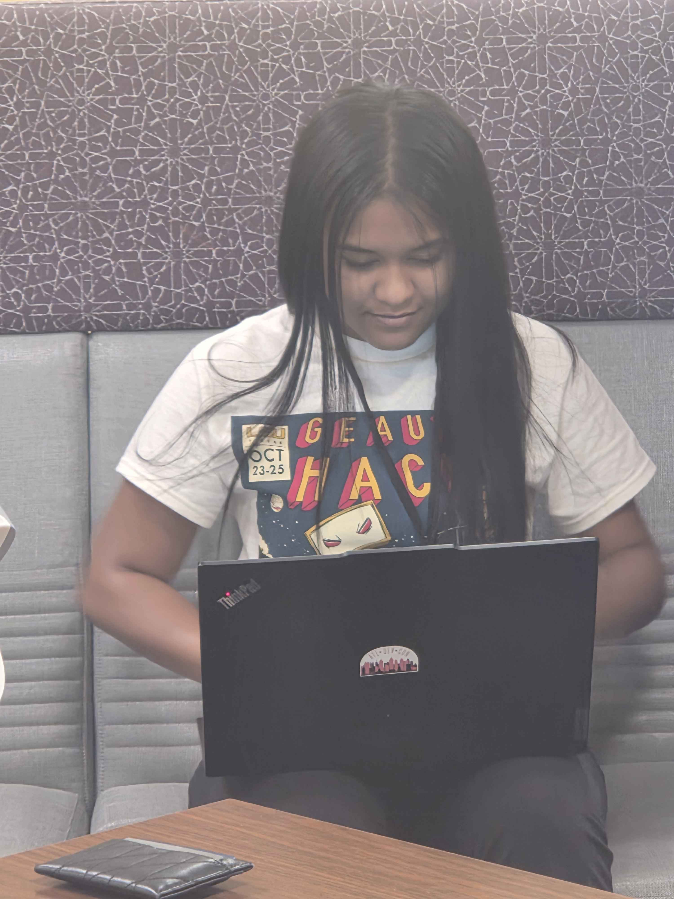
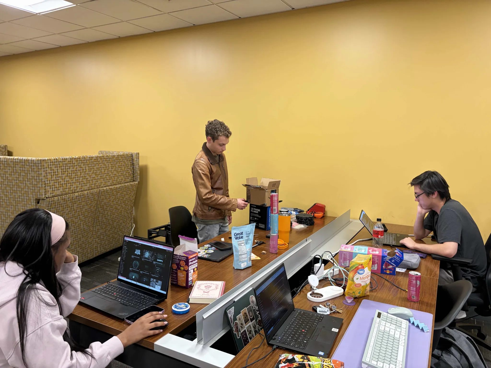
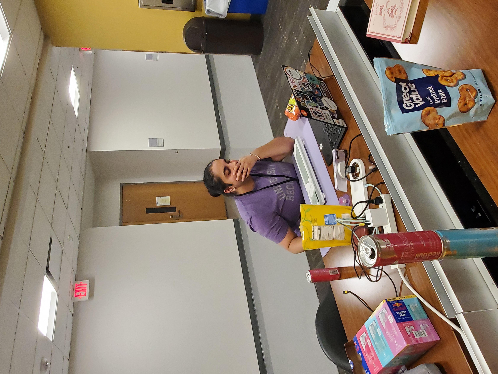
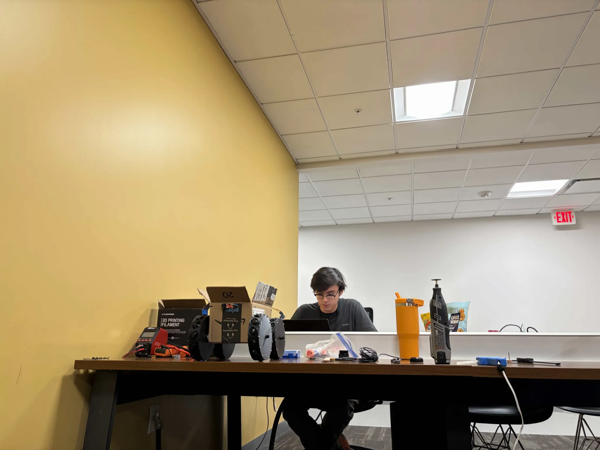

# Prowl

  
   
  
  

   
  A Rover designed to help explore and image terrain on the moon.  
  Developed for the 2026 GeauxHack Hackathon at LSU!

# Prompt
The prompt for this hackathon was **"Life In Space"**, and we decided what's better for space exploration than a rover?

# Goals
Our project goals were to:
- Design a rover which could move around forwards, backwards, and rotate left and right.
- Implement a way to control the rover from any desktop
- Develop a dashboard which would be able to show off the rover's capabilities and sensors
- Develop a Camera and Video streaming to the dashboard

Over time, we were able to successfully accomplish our goals!

# How it Works
We used `ROS2` (Robot Operating System 2) extensively for this project, it was used to allow the peripheral drivers to communicate with each other and the pi seamlessly, using a system of subscribers, publishers, and topics, ROS2 allowed us to wrap device drivers in nodes which could then send data and communicate easily! 

Each of the peripherals are connected to a raspberry pi in different ways. We will go over how the pi reads its data from each of its peripherals in this section!

- **LIDAR - LD19**
The `LD19` LIDAR unit is connected to the RX port of the raspberry pi over UART. It reads data from the sensors and scans them using the `/scan` topic. This is used to send data to the dashboard where you can see the nearest objects to the LD19!

- **IMU - MPU6050**
The `MPU6050` unit is connected to the pi over a data line and clock line, located at pins 3 and 5. it sends data using the `/imu/data_raw` topic, which is then read on the dashboard.

- **DCMC x 2 - DC5-12V 0A-30A**
The DCMCs are used for motor control, they use the `/cmd_vel` and  `/wheel_cmd` topics to communicate with the dashboard, `cmd_vel` stands for "command velocity" and tells all four motors to move forward together. `wheel_cmd` stands for "wheel command" and tells a specific motor to move at a certain velocity.

# Dashboard
The dashboard is connected through a ROS2 wrapper for Node.js, which allows it to communicate with the frontend easily, the front end is able to act as a publisher and subscriber, meaning it can send topics and recieve them just like any other peripheral!

# Credits

  We'd like to thank the following members of our team for their great work on this project!
   
  
   
  Nyla Rivarde
   
  Dashboard: camera view, remote control and alert

   

  
   
  Matthew Beck
   
  Hardware, engineering and DevOps

   

  
   
  Ishaan Acharya
   
  Backend integration layer, WebSocket backend

   

  
   
  WeiEn Greathouse
   
  ROS2 hookup, drivers, and this README :)
  

# AI assistance
Significant portions of the edge code and other documents in the repo were written with help from an AI coding assistant (Claude Code, by Anthropic) during the hackathon, with team members directing the work and testing it on the robot. No code was copied or adapted from other projects; the drivers are written from the hardware datasheets and API documentation.
