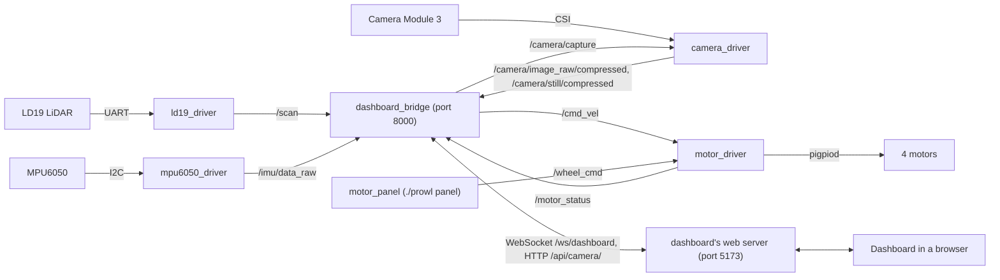

# How it fits together

Each piece of hardware has its own ROS2 driver node, and the nodes talk over ROS2 topics. The dashboard bridge
is a ROS2 node too: it turns the topics the dashboard needs into a WebSocket and a few HTTP addresses, and
turns the dashboard's drive requests into `/cmd_vel`. The browser never speaks ROS.



## What runs where

- **On the Pi itself:** Docker, and the pigpio daemon (`pigpiod`), which the motor driver uses for
  hardware-timed PWM.
- **In the `prowl-edge-dev` container** (ROS2 Jazzy, sharing the Pi's network): the five nodes, started by
  `edge/src/prowl_dashboard_bridge/launch/robot.launch.py`. The workspace (`edge/`) is mounted at `/ws`.
- **In the `prowl-dashboard-web` container** (the same image, for its Node.js): `vite preview`, which serves
  the built dashboard on port 5173 and forwards `/ws` and `/api` to the bridge, so the browser only ever uses
  one address. `./prowl` starts it and removes it when it stops.

## Topics

| Topic | Type | Published by | Used by |
|---|---|---|---|
| `/scan` | `sensor_msgs/LaserScan` | ld19_driver | dashboard bridge |
| `/imu/data_raw` | `sensor_msgs/Imu` | mpu6050_driver | dashboard bridge |
| `/camera/image_raw/compressed` | `sensor_msgs/CompressedImage` (JPEG) | camera_driver | dashboard bridge |
| `/camera/still/compressed` | `sensor_msgs/CompressedImage` (JPEG) | camera_driver, for each `/camera/capture` | dashboard bridge |
| `/camera/capture` | `std_srvs/Trigger` (service) | camera_driver | dashboard bridge |
| `/cmd_vel` | `geometry_msgs/Twist` | dashboard bridge, while someone drives | motor_driver |
| `/wheel_cmd` | `std_msgs/Float64MultiArray` | motor panel | motor_driver |
| `/motor_status` | `std_msgs/Float64MultiArray` | motor_driver | dashboard bridge, motor panel |

The details of each are in [drivers.md](drivers.md), and what the bridge sends the dashboard is in
[protocol.md](protocol.md).

## Conventions

- ROS conventions (REP 103): x forward, y left, z up, angles counter-clockwise, metres and radians.
- Frames: `base_link` is the robot, with `laser_link`, `imu_link` and `camera_link` on it. No TF is
  published; the bridge places the LiDAR on the robot with its `laser_x`, `laser_y` and `laser_yaw` parameters.
- The robot doesn't track its position (there are no wheel encoders and no SLAM), so the dashboard shows the
  LiDAR around the robot rather than a map, and draws the robot in the middle of a decorative survey zone.

## The repo

```
prowl                 the one command: starts the robot and serves the dashboard (docs/setup.md)
edge/                 the robot's code: a ROS2 workspace
  docker/             the dev container: Dockerfile, and dev.sh to manage it (./prowl dev)
  src/
    prowl_motor_driver/       the motor driver node, and the motor panel
    prowl_ld19_driver/        the LiDAR driver node, and a terminal viewer
    prowl_mpu6050_driver/     the IMU driver node, and a terminal monitor
    prowl_camera_driver/      the camera driver node
    prowl_dashboard_bridge/   the dashboard bridge (Node.js), and robot.launch.py
  data/photos/        photos the robot keeps (not in git)
frontend/             the dashboard: a React app built with Vite (docs/dashboard.md)
3d_parts/             STL files for the 3D-printed parts
docs/                 these docs
CLAUDE.md             rules for AI coding agents working in this repo
```

Each ROS2 package has its parameters in `config/` (YAML) and a launch file in `launch/`; all but the motor
driver have unit tests in `test/`.
