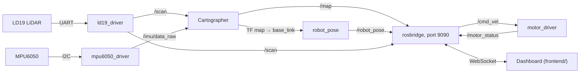

# Prowl Edge Roadmap

**Goal:** Prowl drives around a room and maps it with its LiDAR, and the dashboard (`frontend/`) shows the
live map and the robot's position and can drive it. Every piece talks over ROS2 topics.

| Phase | What | Needs |
|---|---|---|
| 0 | Wiring, and giving the container access to the sensors | nothing |
| 1 | LD19 LiDAR driver, publishing `/scan` (**done**) | 0 |
| 2 | MPU6050 IMU driver, publishing `/imu/data_raw` (**done**; accel calibration still open, see Phase 2) | 0 |
| 3 | Mapping with Cartographer, publishing `/map` | 1 and 2 |
| 4 | Dashboard link over rosbridge | motor parts work now; the map needs 3 |

Phases 1 and 2 don't depend on each other, so two people can do them at the same time. The motor status and
drive controls in Phase 4 can start right away.

Ground rules:

- Our drivers are written from scratch from the datasheets. Don't use or adapt LDRobot's `ldlidar_stl_ros2`
  or Adafruit's MPU6050 libraries. Existing ROS packages that we use as-is (Cartographer, rosbridge) are fine.
- None of this needs an external API (the project limit is 2).
- ROS conventions (REP 103): x forward, y left, z up, angles counter-clockwise, meters and radians.

## How it connects



| Topic | Type | Published by | Used by |
|---|---|---|---|
| `/scan` | `sensor_msgs/LaserScan` | ld19_driver | Cartographer, dashboard |
| `/imu/data_raw` | `sensor_msgs/Imu` | mpu6050_driver | Cartographer |
| `/map` | `nav_msgs/OccupancyGrid` | Cartographer | dashboard |
| `/robot_pose` | `geometry_msgs/PoseStamped` | robot_pose | dashboard |
| `/cmd_vel` | `geometry_msgs/Twist` | dashboard | motor_driver |
| `/motor_status` | `std_msgs/Float64MultiArray` | motor_driver | dashboard |

Coordinate frames: `map → odom → base_link → laser_link` and `base_link → imu_link`. Cartographer publishes
`map → odom → base_link`; two static transforms in the launch file give `laser_link` and `imu_link`.

## Phase 0: Wiring and container access

Neither sensor shares a pin with the motors.

| Sensor pin | Pi header pin |
|---|---|
| LD19 P5V | 5V (pin 4) |
| LD19 GND | GND (pin 6) |
| LD19 Tx | GPIO15, RXD (pin 10) |
| LD19 PWM | GND (pin 25). The manual says it must be grounded when unused; grounded means its own 10 Hz speed control |
| MPU6050 VIN | 3.3V (pin 1) |
| MPU6050 GND | GND (pin 9) |
| MPU6050 SDA | GPIO2 (pin 3) |
| MPU6050 SCL | GPIO3 (pin 5) |

This is how the robot is wired now: the LD19 is on the mini UART (`/dev/ttyS0`, enabled by `enable_uart=1`)
and the MPU6050 on I2C bus 1 (`/dev/i2c-1`). `docker/dev.sh up` already passes both into the container.

1. Check the IMU: `docker/dev.sh i2cdetect -y 1` should show `68`.
2. Check the LiDAR: `docker/dev.sh bash -c 'stty -F /dev/ttyS0 230400 raw -echo; timeout 2 od -An -tx1 /dev/ttyS0 | head'`
   should show bytes, with `54 2c` appearing regularly.
3. Before Phases 3 and 4, add `ros-jazzy-cartographer-ros ros-jazzy-rosbridge-suite` to the `apt-get install`
   line in `docker/Dockerfile`. Then, with no live driver running, rebuild and recreate the container:
   `docker/dev.sh down && docker/dev.sh image && docker/dev.sh up`

## Phase 1: LD19 LiDAR driver (`prowl_ld19_driver`)

**Status: done.** `ld19_node` publishes `/scan` at 10 Hz on the robot with no CRC errors; see the README for how
to run it. Two things differ from the plan below: the scan uses a negative `angle_increment` (step 4), and the
LD19 sends about 416 packets a second, not 375 (step 6).

Source: [LD19 Development Manual V2.3](https://www.elecrow.com/download/product/SLD06360F/LD19_Development%20Manual_V2.3.pdf).
What the driver needs from it:

- UART at 230400 baud, 8N1, no flow control. It's one-way: the LiDAR streams data as soon as it's spinning
  and takes no commands.
- 47-byte packets, little-endian:

  | Bytes | Field |
  |---|---|
  | 1 | Header, `0x54` |
  | 1 | `0x2C`: packet type 1, 12 points per packet |
  | 2 | Rotation speed, degrees per second |
  | 2 | Start angle, in 0.01° |
  | 12 × 3 | Points: distance (2 bytes, mm), then intensity (1 byte) |
  | 2 | End angle, in 0.01° |
  | 2 | Timestamp, ms (wraps at 30000) |
  | 1 | CRC-8 of the 46 bytes before it |

- CRC-8 settings: polynomial `0x4D`, initial value 0, no reflection, no final XOR. These reproduce the
  manual's lookup table, so compute the CRC rather than copying the table. The manual's example packet (§3.3)
  checks out to `0x50`.
- Point angles: `step = (end − start) / 11` and `angle_i = start + step × i`. When a packet crosses 0°,
  `end < start`; add 360° to `end` first. (The manual doesn't mention this case.)
- Angles increase **clockwise**, with 0° at the sensor's front (§4). ROS angles go counter-clockwise, so use
  `−angle`.
- Measured on Prowl: about 5000 measurements (416 packets) per second at 10 rotations per second, so roughly
  500 points per rotation, about 0.7° apart. (The manual's 4500 per second would give 375 packets.) Distance 0 means no return. A white object within 6 m reads an intensity of about 200.

Steps:

1. Open the port (param `port`, default `/dev/ttyS0`) with termios: raw mode, 230400, 8N1. Read it in a
   background thread.
2. Write the packet parser as plain C++ with no ROS in it, so it's easy to test. Look for `0x54 0x2C`, collect
   47 bytes, and check the CRC. On a bad CRC, drop one byte and search again, and count the error.
3. Unit tests (`ament_cmake_gtest`), which need no hardware:
   - The manual's example packet gives speed 2152 °/s, start 324.27°, end 334.70°, first point 224 mm with
     intensity 228, and CRC `0x50`.
   - A packet that crosses 0°.
   - A packet with one flipped byte, which must fail the CRC.
4. Collect points into one full rotation. When the angle wraps around, publish that rotation as a
   `sensor_msgs/LaserScan`:
   - `frame_id` `laser_link`. Use fixed bins, e.g. 0.5° (720 bins), with `angle_min` 0 and
     `angle_increment` **−**2π/720, so bin i is sensor angle i × 0.5° clockwise (ROS angle `−angle`). The
     LD19 spins clockwise, so this keeps the bins in the order they were measured, which is what
     `time_increment` assumes; Cartographer uses it to correct scans for the robot's motion. A positive
     increment would list the points backwards in time.
   - Empty bins and distance-0 points are `+inf`. Make `range_min` and `range_max` params; check the LD19
     spec sheet, which gives about 0.02–12 m.
   - `scan_time` = 360 / speed, `time_increment` = `scan_time` / bins, stamp = when the rotation started.
     Fill in `intensities` too.
5. Params: `port`, `frame_id`, `range_min`, `range_max`, `bins`, and `min_intensity` (drops weak points;
   start at 0). Publish with the default (reliable) QoS so every kind of subscriber can connect.
6. Every few seconds, log rotations per second, packets per second (about 416), and CRC errors.

**Done when:** the tests pass, `ros2 topic hz /scan` shows about 10 Hz, and a box held in front of the LiDAR
shows up at angle 0, then moves to +90° when you move it to the LiDAR's left.

## Phase 2: MPU6050 IMU driver (`prowl_mpu6050_driver`)

**Status: done.** `mpu6050_node` publishes `/imu/data_raw` at 100 Hz on the robot.

Gyro calibration (fixed 2026-10-24): on the first runs the startup calibration rejected the robot as "not
still", because the spinning LiDAR shakes the board at its 10 Hz rotation rate (X swung by up to ±8 °/s).
The stillness check now averages the gyro over 0.1 s blocks, one LiDAR rotation, which cancels that
vibration but not real movement; see the README. On the robot, with the LiDAR spinning, three runs in a row
were accepted first time: the movement figure was about 0.05 °/s against a limit of 0.3, the bias came out
at about (−1.88, −1.14, +0.35) °/s and repeated within 0.03 °/s, and the corrected gyro then averaged within
0.03 °/s of zero. The raw vibration is much smaller now (X noise about 0.25 °/s, a 0.24 °/s peak at
9.96 Hz), so the mounting looks fine.

Still open:

- **Accelerometer offsets.** Standing still, `|a|` reads 9.11 m/s² instead of 9.81 (about 70 mg low,
  within the MPU-6050's zero-g offset spec). Finding per-axis offsets needs a six-position calibration,
  i.e. resting the robot on each side in turn, which wasn't possible yet. Cartographer only uses the
  direction of gravity, so this doesn't block Phase 3.
- **Gyro bias drifts with temperature.** Over 3 minutes the chip warmed by 0.7 °C and the Z bias rose by
  about 0.08 °/s (roughly 0.1 °/s per °C). The bias is only measured at startup, so start the driver once
  the robot has warmed up, or restart it before a long mapping run. Scan matching corrects slow heading
  drift.
- Turning the robot left to check for a positive `angular_velocity.z` (the last "done when" check) still
  needs the robot moved.

Sources: the [Adafruit MPU6050 guide](https://cdn-learn.adafruit.com/downloads/pdf/mpu6050-6-dof-accelerometer-and-gyro.pdf)
for the board and wiring, and the InvenSense
[MPU-6000/6050 Register Map](https://cdn.sparkfun.com/datasheets/Sensors/Accelerometers/RM-MPU-6000A.pdf)
(linked from the guide's Downloads) for the registers.

- I2C address `0x68` (`0x69` if AD0 is pulled high). The breakout takes 3–5 V and has 10 kΩ pull-ups.
- The chip powers up asleep. `WHO_AM_I` (`0x75`) reads `0x68`.
- Registers:
  - `PWR_MGMT_1` `0x6B`
  - `SMPLRT_DIV` `0x19`
  - `CONFIG` `0x1A` (low-pass filter)
  - `GYRO_CONFIG` `0x1B` and `ACCEL_CONFIG` `0x1C` (range in bits 4:3)
  - Data at `0x3B`–`0x48`: 14 bytes holding accel X/Y/Z, temperature, then gyro X/Y/Z, each a big-endian
    signed 16-bit value
- Scale:
  - Accel ±2/4/8/16 g = 16384/8192/4096/2048 LSB per g.
  - Gyro ±250/500/1000/2000 °/s = 131/65.5/32.8/16.4 LSB per °/s.
  - Temperature in °C = raw / 340 + 36.53.
- Sample rate = 1 kHz / (1 + `SMPLRT_DIV`) while the low-pass filter is on.

Steps:

1. Open `/dev/i2c-1` (param `bus`) and select the chip with `ioctl(fd, I2C_SLAVE, 0x68)`. To read registers,
   write the register address, then read the bytes.
2. Setup, in this order:
   - Check `WHO_AM_I`. Warn rather than fail if it isn't `0x68`, since clone chips report other values.
   - `PWR_MGMT_1` = `0x80` (reset), then wait 100 ms.
   - `PWR_MGMT_1` = `0x01` (wake up, use the gyro clock).
   - `CONFIG` = `0x03` (~44 Hz filter).
   - `SMPLRT_DIV` = 9 (100 Hz).
   - `GYRO_CONFIG` = `0x08` (±500 °/s).
   - `ACCEL_CONFIG` = `0x08` (±4 g).
3. At 100 Hz, read the 14 bytes from `0x3B` and convert them. Accel to m/s²: raw / LSB per g × 9.80665. Gyro
   to rad/s: raw / LSB per °/s × π/180.
4. At startup, average about 2 s of gyro readings with the robot still, and subtract that bias from then on.
5. Publish `sensor_msgs/Imu` on `/imu/data_raw` with `frame_id` `imu_link`. Fill in angular velocity and
   linear acceleration, keeping gravity in because Cartographer expects it. Set `orientation_covariance[0]`
   to −1, which means "no orientation".
6. Mount the board flat with its X arrow pointing forward, and its axes already match ROS. If you can't, set
   the rotation in the static transform instead (Phase 3).
7. Unit test the raw-to-SI conversion.

**Done when:** standing still gives an acceleration of about (0, 0, +9.8) m/s² and a gyro of about 0, turning
the robot left (counter-clockwise from above) gives a positive `angular_velocity.z`, and
`ros2 topic hz /imu/data_raw` shows about 100 Hz.

## Phase 3: Mapping with Cartographer

Prowl has no wheel encoders, so there's no odometry. Cartographer's 2D SLAM builds the map from LiDAR scan
matching plus the IMU, with no odometry needed, and it's packaged for Jazzy (`ros-jazzy-cartographer-ros`).
`slam_toolbox`, the other common choice, needs an odometry source we don't have.

1. Create a `prowl_bringup` package with `config/cartographer_2d.lua` and `launch/prowl.launch.py`.
2. Measure where the LiDAR and IMU sit relative to the robot's center. Add two `static_transform_publisher`
   nodes to the launch file:
   - `base_link → laser_link`, rotated so the LiDAR's 0° faces forward.
   - `base_link → imu_link`.
3. Write the Lua config from the
   [Cartographer ROS configuration docs](https://google-cartographer-ros.readthedocs.io/en/latest/configuration.html).
   Cartographer won't start if any option in the `options` table is missing, so work through the full list
   in the docs. The values that matter here:
   - `map_frame = "map"`, `tracking_frame = "imu_link"`, `published_frame = "base_link"`,
     `odom_frame = "odom"`
   - `provide_odom_frame = true`, `use_odometry = false`, `num_laser_scans = 1`
   - `MAP_BUILDER.use_trajectory_builder_2d = true` and `TRAJECTORY_BUILDER_2D.use_imu_data = true`
   - `TRAJECTORY_BUILDER_2D.min_range` / `max_range`, matching the LiDAR driver
   - `TRAJECTORY_BUILDER_2D.use_online_correlative_scan_matching = true`, which helps a lot without
     odometry
4. Launch two nodes:
   - `cartographer_node`, with `-configuration_directory` and `-configuration_basename cartographer_2d.lua`,
     remapping `scan → /scan` and `imu → /imu/data_raw`.
   - `cartographer_occupancy_grid_node` (`-resolution 0.05 -publish_period_sec 1.0`), which publishes `/map`.
5. Record one test drive (`ros2 bag record /scan /imu/data_raw /tf_static`). Then you can replay it and tune
   the config without driving the robot again.

Tips: drive slowly, especially when turning. Without odometry, fast spins are where scan matching loses
track. Featureless spaces, like long blank corridors, are hard for any LiDAR SLAM.

**Done when:** a slow loop around a room gives a clean map, and the robot's position on it follows the real
robot.

## Phase 4: Dashboard link

The dashboard connects straight to the robot: the browser opens a WebSocket to rosbridge on the Pi. No
backend is needed.

Edge side:

1. Add rosbridge to `prowl.launch.py` by including `rosbridge_server`'s `rosbridge_websocket_launch.xml`. It
   listens on port 9090.
2. Write a small `robot_pose` node in `prowl_bringup`. Every 0.1 s, it looks up the transform
   `map → base_link` and publishes it as `/robot_pose` (`geometry_msgs/PoseStamped`), so the dashboard
   doesn't have to do any transform math.
3. Add `motor_driver` to the launch file with a `live` argument that defaults to false (dry run).

Frontend side (`frontend/`):

1. Run `npm install roslib` (v2.x) and connect to `ws://<pi address>:9090`. Use the connection events to drive
   the header's Connected/Disconnected status, and hide the demo-mode banner while connected.
2. Map: subscribe to `/map` at most once a second and draw it on a canvas. Cells are row-major, starting at
   `info.origin`, `info.resolution` meters per cell. Values are −1 for unknown, 0 for free, 100 for occupied.
3. Robot: subscribe to `/robot_pose`. Draw a marker at `pose.position`, with heading
   `yaw = atan2(2(w·z + x·y), 1 − 2(y² + z²))` from `pose.orientation`.
4. LiDAR: subscribe to `/scan`, throttled to about 5 a second. Point i is at angle
   `angle_min + i × angle_increment` and distance `ranges[i]`, relative to the robot.
5. Motor status: `/motor_status` `data` holds four duties, in the order front_left, rear_left, front_right,
   rear_right.
6. Driving: while a button or key is held, publish `/cmd_vel` (`linear.x`, `linear.y`, `angular.z`) 10 times
   a second, and send zeros once on release. The driver stops by itself 0.5 s after messages stop, so a
   dropped connection also stops the robot.

rosbridge has no login, so anyone on the same network can drive the robot. Use a private hotspot for the
demo, not shared Wi-Fi.

**Done when:** the dashboard shows the live map, the robot and the LiDAR points, and can drive the robot.

## Putting it together

One launch file runs the whole demo:

```bash
docker/dev.sh ros2 launch prowl_bringup prowl.launch.py live:=true
```

It starts both sensor drivers, the static transforms, Cartographer, rosbridge, `robot_pose` and the motor
driver. `./prowl` still works for motor-only testing. While the launch file's driver is running, the panel
shows `RUNNING (started outside the panel)` but can still drive.

## After the hackathon

- Measure `wheel_separation`, `wheel_base` and `max_linear_speed` (TODOs in `motor_driver.yaml`).
- Add wheel encoders for real odometry, then `slam_toolbox` and Nav2 for autonomous driving (click a goal on
  the dashboard).
- Save and reload maps.
- Add the camera stream (left out for now).
- Put a login in front of rosbridge, or route the dashboard through `backend/`.
