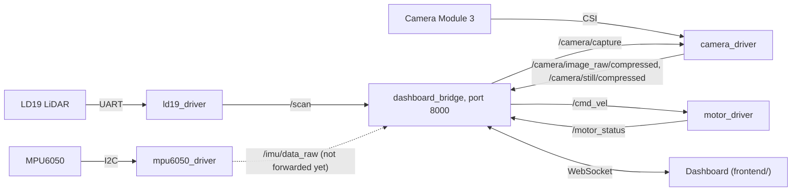

# Prowl Edge Roadmap

**Goal:** Prowl drives around while the dashboard (`frontend/`) shows what its LiDAR, IMU and camera see
and what its motors are doing, and can drive it. Every piece talks over ROS2 topics.

| Phase | What | Needs |
|---|---|---|
| 0 | Wiring, and giving the container access to the sensors | nothing |
| 1 | LD19 LiDAR driver, publishing `/scan` (**done**) | 0 |
| 2 | MPU6050 IMU driver, publishing `/imu/data_raw` (**done**; accel calibration still open, see Phase 2) | 0 |
| 3 | Dashboard link through our own bridge (**bridge done**, tested in dry run; see Phase 3) | motor parts work now; the sensor data needs 1, 2 and 4 |
| 4 | Camera Module 3 driver: JPEG video on `/camera/image_raw/compressed`, photos on request (**done**) | nothing |

Phases 1 and 2 don't depend on each other, so two people can do them at the same time. The motor status and
drive controls in Phase 3 can start right away.

Ground rules:

- Our drivers are written from scratch from the datasheets. Don't use or adapt LDRobot's `ldlidar_stl_ros2`
  or Adafruit's MPU6050 libraries. Existing packages that we use as-is (such as rclnodejs) are fine.
- None of this needs an external API (the project limit is 2).
- ROS conventions (REP 103): x forward, y left, z up, angles counter-clockwise, meters and radians.

## How it connects



| Topic | Type | Published by | Used by |
|---|---|---|---|
| `/scan` | `sensor_msgs/LaserScan` | ld19_driver | dashboard |
| `/imu/data_raw` | `sensor_msgs/Imu` | mpu6050_driver | dashboard, once the bridge forwards it (Phase 3) |
| `/cmd_vel` | `geometry_msgs/Twist` | dashboard | motor_driver |
| `/motor_status` | `std_msgs/Float64MultiArray` | motor_driver | dashboard |
| `/camera/image_raw/compressed` | `sensor_msgs/CompressedImage` | camera_driver | dashboard (as MJPEG) |
| `/camera/image_raw` | `sensor_msgs/Image` | camera_driver, only while subscribed | nothing yet |
| `/camera/still/compressed` | `sensor_msgs/CompressedImage` | camera_driver, per `/camera/capture` | dashboard |

The bridge also subscribes to `/robot_pose` and `/map`, but nothing publishes them, so the dashboard gets
neither and the scan points are drawn as if the robot sat at the origin facing +x.

Frames: `laser_link` for the LiDAR and `imu_link` for the IMU, both mounted on `base_link`. No TF is
published; the bridge places the LiDAR on the robot with its `laser_x`, `laser_y` and `laser_yaw` parameters.

## Phase 0: Wiring and container access

Neither sensor shares a pin with the motors.

| Sensor pin | Pi header pin |
|---|---|
| LD19 P5V | 5V (pin 4) |
| LD19 GND | GND (pin 6) |
| LD19 Tx | GPIO15, RXD (pin 10) |
| LD19 PWM | GND (pin 25). The manual says it must be grounded when unused; grounded means its own 10 Hz speed control |
| MPU6050 VIN | 3.3V (pin 1) |
| MPU6050 GND | GND (pin 9) |
| MPU6050 SDA | GPIO2 (pin 3) |
| MPU6050 SCL | GPIO3 (pin 5) |

This is how the robot is wired now: the LD19 is on the mini UART (`/dev/ttyS0`, enabled by `enable_uart=1`)
and the MPU6050 on I2C bus 1 (`/dev/i2c-1`). `docker/dev.sh up` already passes both into the container.

1. Check the IMU: `docker/dev.sh i2cdetect -y 1` should show `68`.
2. Check the LiDAR: `docker/dev.sh bash -c 'stty -F /dev/ttyS0 230400 raw -echo; timeout 2 od -An -tx1 /dev/ttyS0 | head'`
   should show bytes, with `54 2c` appearing regularly.

## Phase 1: LD19 LiDAR driver (`prowl_ld19_driver`)

**Status: done.** `ld19_node` publishes `/scan` at 10 Hz on the robot with no CRC errors; see the README for how
to run it. Two things differ from the plan below: the scan uses a negative `angle_increment` (step 4), and the
LD19 sends about 416 packets a second, not 375 (step 6).

Source: [LD19 Development Manual V2.3](https://www.elecrow.com/download/product/SLD06360F/LD19_Development%20Manual_V2.3.pdf).
What the driver needs from it:

- UART at 230400 baud, 8N1, no flow control. It's one-way: the LiDAR streams data as soon as it's spinning
  and takes no commands.
- 47-byte packets, little-endian:

  | Bytes | Field |
  |---|---|
  | 1 | Header, `0x54` |
  | 1 | `0x2C`: packet type 1, 12 points per packet |
  | 2 | Rotation speed, degrees per second |
  | 2 | Start angle, in 0.01° |
  | 12 × 3 | Points: distance (2 bytes, mm), then intensity (1 byte) |
  | 2 | End angle, in 0.01° |
  | 2 | Timestamp, ms (wraps at 30000) |
  | 1 | CRC-8 of the 46 bytes before it |

- CRC-8 settings: polynomial `0x4D`, initial value 0, no reflection, no final XOR. These reproduce the
  manual's lookup table, so compute the CRC rather than copying the table. The manual's example packet (§3.3)
  checks out to `0x50`.
- Point angles: `step = (end − start) / 11` and `angle_i = start + step × i`. When a packet crosses 0°,
  `end < start`; add 360° to `end` first. (The manual doesn't mention this case.)
- Angles increase **clockwise**, with 0° at the sensor's front (§4). ROS angles go counter-clockwise, so use
  `−angle`.
- Measured on Prowl: about 5000 measurements (416 packets) per second at 10 rotations per second, so roughly
  500 points per rotation, about 0.7° apart. (The manual's 4500 per second would give 375 packets.) Distance 0 means no return. A white object within 6 m reads an intensity of about 200.

Steps:

1. Open the port (param `port`, default `/dev/ttyS0`) with termios: raw mode, 230400, 8N1. Read it in a
   background thread.
2. Write the packet parser as plain C++ with no ROS in it, so it's easy to test. Look for `0x54 0x2C`, collect
   47 bytes, and check the CRC. On a bad CRC, drop one byte and search again, and count the error.
3. Unit tests (`ament_cmake_gtest`), which need no hardware:
   - The manual's example packet gives speed 2152 °/s, start 324.27°, end 334.70°, first point 224 mm with
     intensity 228, and CRC `0x50`.
   - A packet that crosses 0°.
   - A packet with one flipped byte, which must fail the CRC.
4. Collect points into one full rotation. When the angle wraps around, publish that rotation as a
   `sensor_msgs/LaserScan`:
   - `frame_id` `laser_link`. Use fixed bins, e.g. 0.5° (720 bins), with `angle_min` 0 and
     `angle_increment` **−**2π/720, so bin i is sensor angle i × 0.5° clockwise (ROS angle `−angle`). The
     LD19 spins clockwise, so this keeps the bins in the order they were measured, which is what
     `time_increment` assumes. A positive increment would list the points backwards in time.
   - Empty bins and distance-0 points are `+inf`. Make `range_min` and `range_max` params; check the LD19
     spec sheet, which gives about 0.02–12 m.
   - `scan_time` = 360 / speed, `time_increment` = `scan_time` / bins, stamp = when the rotation started.
     Fill in `intensities` too.
5. Params: `port`, `frame_id`, `range_min`, `range_max`, `bins`, and `min_intensity` (drops weak points;
   start at 0). Publish with the default (reliable) QoS so every kind of subscriber can connect.
6. Every few seconds, log rotations per second, packets per second (about 416), and CRC errors.

**Done when:** the tests pass, `ros2 topic hz /scan` shows about 10 Hz, and a box held in front of the LiDAR
shows up at angle 0, then moves to +90° when you move it to the LiDAR's left.

## Phase 2: MPU6050 IMU driver (`prowl_mpu6050_driver`)

**Status: done.** `mpu6050_node` publishes `/imu/data_raw` at 100 Hz on the robot.

Gyro calibration (fixed 2026-10-24): on the first runs the startup calibration rejected the robot as "not
still", because the spinning LiDAR shakes the board at its 10 Hz rotation rate (X swung by up to ±8 °/s).
The stillness check now averages the gyro over 0.1 s blocks, one LiDAR rotation, which cancels that
vibration but not real movement; see the README. On the robot, with the LiDAR spinning, three runs in a row
were accepted first time: the movement figure was about 0.05 °/s against a limit of 0.3, the bias came out
at about (−1.88, −1.14, +0.35) °/s and repeated within 0.03 °/s, and the corrected gyro then averaged within
0.03 °/s of zero. The raw vibration is much smaller now (X noise about 0.25 °/s, a 0.24 °/s peak at
9.96 Hz), so the mounting looks fine.

Still open:

- **Accelerometer offsets.** Standing still, `|a|` reads 9.11 m/s² instead of 9.81 (about 70 mg low,
  within the MPU-6050's zero-g offset spec). Finding per-axis offsets needs a six-position calibration,
  i.e. resting the robot on each side in turn, which wasn't possible yet.
- **Gyro bias drifts with temperature.** Over 3 minutes the chip warmed by 0.7 °C and the Z bias rose by
  about 0.08 °/s (roughly 0.1 °/s per °C). The bias is only measured at startup, so start the driver once
  the robot has warmed up, or restart it before a long run.
- Turning the robot left to check for a positive `angular_velocity.z` (the last "done when" check) still
  needs the robot moved.

Sources: the [Adafruit MPU6050 guide](https://cdn-learn.adafruit.com/downloads/pdf/mpu6050-6-dof-accelerometer-and-gyro.pdf)
for the board and wiring, and the InvenSense
[MPU-6000/6050 Register Map](https://cdn.sparkfun.com/datasheets/Sensors/Accelerometers/RM-MPU-6000A.pdf)
(linked from the guide's Downloads) for the registers.

- I2C address `0x68` (`0x69` if AD0 is pulled high). The breakout takes 3–5 V and has 10 kΩ pull-ups.
- The chip powers up asleep. `WHO_AM_I` (`0x75`) reads `0x68`.
- Registers:
  - `PWR_MGMT_1` `0x6B`
  - `SMPLRT_DIV` `0x19`
  - `CONFIG` `0x1A` (low-pass filter)
  - `GYRO_CONFIG` `0x1B` and `ACCEL_CONFIG` `0x1C` (range in bits 4:3)
  - Data at `0x3B`–`0x48`: 14 bytes holding accel X/Y/Z, temperature, then gyro X/Y/Z, each a big-endian
    signed 16-bit value
- Scale:
  - Accel ±2/4/8/16 g = 16384/8192/4096/2048 LSB per g.
  - Gyro ±250/500/1000/2000 °/s = 131/65.5/32.8/16.4 LSB per °/s.
  - Temperature in °C = raw / 340 + 36.53.
- Sample rate = 1 kHz / (1 + `SMPLRT_DIV`) while the low-pass filter is on.

Steps:

1. Open `/dev/i2c-1` (param `bus`) and select the chip with `ioctl(fd, I2C_SLAVE, 0x68)`. To read registers,
   write the register address, then read the bytes.
2. Setup, in this order:
   - Check `WHO_AM_I`. Warn rather than fail if it isn't `0x68`, since clone chips report other values.
   - `PWR_MGMT_1` = `0x80` (reset), then wait 100 ms.
   - `PWR_MGMT_1` = `0x01` (wake up, use the gyro clock).
   - `CONFIG` = `0x03` (~44 Hz filter).
   - `SMPLRT_DIV` = 9 (100 Hz).
   - `GYRO_CONFIG` = `0x08` (±500 °/s).
   - `ACCEL_CONFIG` = `0x08` (±4 g).
3. At 100 Hz, read the 14 bytes from `0x3B` and convert them. Accel to m/s²: raw / LSB per g × 9.80665. Gyro
   to rad/s: raw / LSB per °/s × π/180.
4. At startup, average about 2 s of gyro readings with the robot still, and subtract that bias from then on.
5. Publish `sensor_msgs/Imu` on `/imu/data_raw` with `frame_id` `imu_link`. Fill in angular velocity and
   linear acceleration, keeping gravity in as `sensor_msgs/Imu` expects. Set `orientation_covariance[0]`
   to −1, which means "no orientation".
6. Mount the board flat with its X arrow pointing forward, and its axes already match ROS. If you can't,
   note the rotation so whatever reads `/imu/data_raw` can correct for it.
7. Unit test the raw-to-SI conversion.

**Done when:** standing still gives an acceleration of about (0, 0, +9.8) m/s² and a gyro of about 0, turning
the robot left (counter-clockwise from above) gives a positive `angular_velocity.z`, and
`ros2 topic hz /imu/data_raw` shows about 100 Hz.

## Phase 3: Dashboard link

The dashboard connects straight to the robot, with no backend in between. This was going to be rosbridge,
but it's now our own bridge, `prowl_dashboard_bridge`: a ROS2 node written in Node.js (rclnodejs + ws) that
serves the backend's `/ws/dashboard` protocol on port 8000. Next to rosbridge, it only lets the browser
drive (with an optional token and speed limits), not publish any topic. It slims the data down on the Pi,
and the dashboard's existing live code works with it unchanged. Messages:
[`src/prowl_dashboard_bridge/PROTOCOL.md`](src/prowl_dashboard_bridge/PROTOCOL.md).

Edge side:

1. ~~Bridge node: `/robot_pose`, `/scan`, `/map`, `/motor_status` to the dashboard, drive requests to
   `/cmd_vel`.~~ Done, tested in dry run.
2. ~~Forward `/imu/data_raw` to the dashboard.~~ Done: an `imu` message 5 times a second, each the average
   of the readings since the last one.
3. ~~Add the IMU driver to `test_page.launch.py`.~~ Done. The bridge also tells the dashboard whether the
   motor driver is live or in dry run (`status.motors`), and saves every photo for the Photos page.
4. Measure the LiDAR's position on the robot (`laser_x`, `laser_y`, `laser_yaw` in
   `dashboard_bridge.yaml`), so scan points sit in the right place around the robot.

Frontend side (`frontend/`):

1. ~~Hold-to-drive: `src/live/useDrive.js`.~~ Done; it sends drive requests 10 times a second while a
   button is held and a zero on release. `useProwlLink` passes the page's `?token=` on to the socket.
2. Point the dashboard at the robot: `PROWL_BACKEND=http://<pi address>:8000` in `frontend/.env.local`.
3. ~~Drive buttons, wheel duties, IMU and the LiDAR.~~ Done: the remote-control bar under the map and the
   LiDAR scope (`FRONTEND_HOOKUP.md`, "Status").
4. ~~Live camera, "take photo", and the Photos page.~~ Done. Still to do on the robot: a live drive check,
   and checking the scope against the real room.

Without a `drive_token`, anyone on the same network can drive the robot. Set one, and use a private hotspot
for the demo, not shared Wi-Fi.

**Done when:** the dashboard shows the LiDAR points around the robot, the camera, the wheel duties and the
IMU readings, and can drive the robot.

## Phase 4: Camera driver (`prowl_camera_driver`)

**Status: done.** On the robot: 1280×720 JPEG video at 30 fps with no dropped frames, and 4608×2592 photos
in about 0.8 s. The bridge serves both over HTTP (`/api/camera/`), and its test page shows them. See the
README for how to run it.

The camera is a Camera Module 3 Wide (IMX708 sensor) on the CSI port. There's no register-level manual
for it, so the driver works through [libcamera](https://libcamera.org/api-html/), the Pi's camera stack:
it runs the sensor, the CSI receiver and the ISP, plus exposure, white balance and autofocus, with tuning
for the IMX708. The [Pi's camera docs](https://www.raspberrypi.com/documentation/accessories/camera.html)
give the sensor modes and the `rpicam` tools for checking it outside ROS. What the driver does:

1. Video: one YUV 4:2:0 stream at 1280×720, read from the 2304×1296 sensor mode (the whole field of view; by
   itself libcamera picks a 1536×864 crop for 720p). Frame rate fixed with `FrameDurationLimits`, continuous
   autofocus with `AfMode`.
2. Each frame goes straight into TurboJPEG: in the sYCC colour space the ISP's YUV is already what a JPEG
   stores. RGB is only made for `/camera/image_raw` subscribers.
3. Photos: stop, reconfigure for the full 4608×2592 mode, skip a few frames while exposure and focus settle,
   encode one, and go back to video.

Still open:

- **Where it sits on the robot.** Measure it for a `camera_link` transform, together with the LiDAR's.
- **Calibration.** No `camera_info` yet. Detection that needs angles or distances (the backend protocol's
  camera "samples") needs the lens calibrated first.

## Putting it together

One launch file runs the whole demo:

```bash
docker/dev.sh ros2 launch prowl_dashboard_bridge test_page.launch.py live:=true
```

It starts the LD19 driver, the IMU driver, the camera driver, the motor driver and the dashboard bridge.
Without `live:=true` the motors stay in dry run, and the test page and dashboard say so. `./prowl` still works for motor-only testing. While the launch file's driver is running, the
panel shows `RUNNING (started outside the panel)` but can still drive.

## After the hackathon

- Measure `wheel_separation`, `wheel_base` and `max_linear_speed` (TODOs in `motor_driver.yaml`).
- Add wheel encoders for real odometry.
- Hardware H.264 video (the Pi 4's encoder) if MJPEG uses too much Wi-Fi.
- Real logins for the dashboard bridge instead of one shared token, or route the dashboard through `backend/`.
